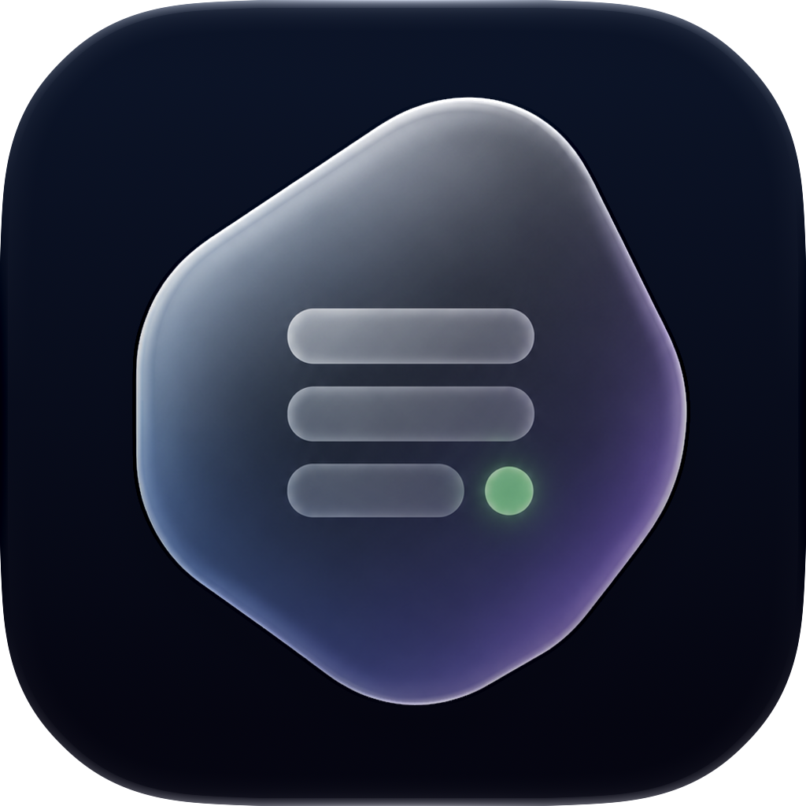
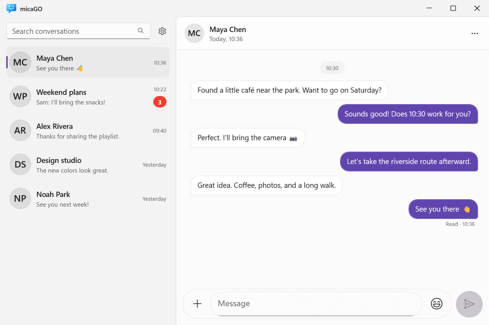
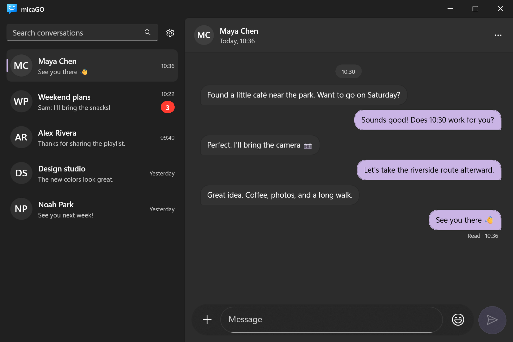
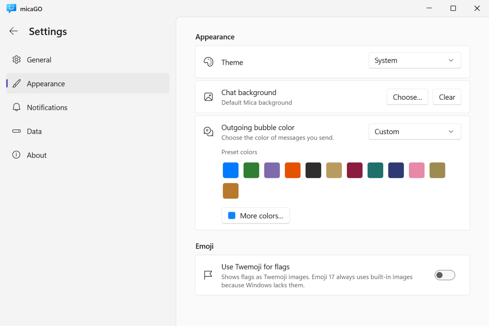
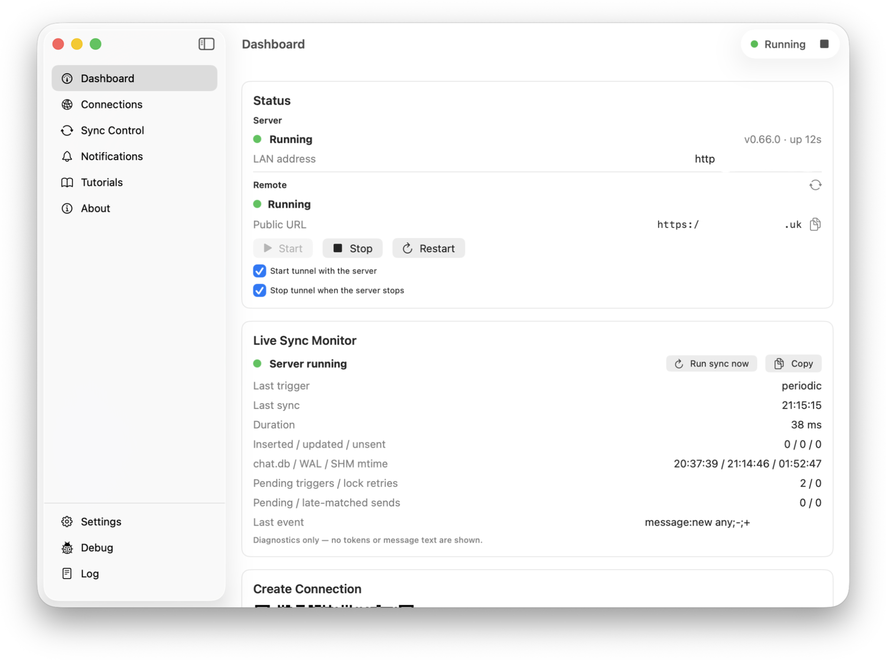
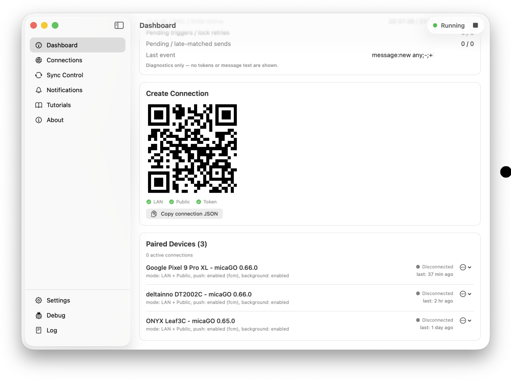
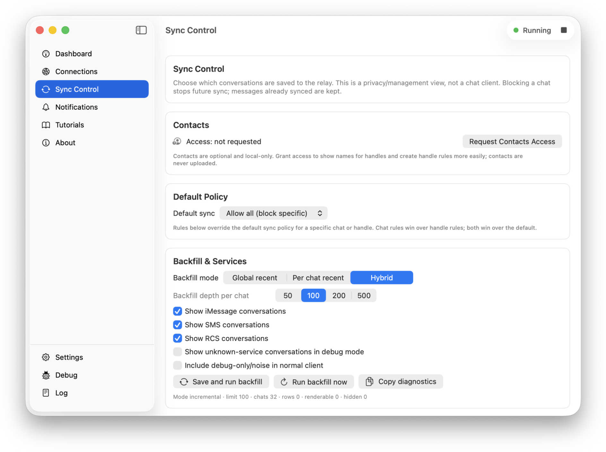

# micaGO

[English](README.md) · [简体中文](README.zh-Hans.md) · [繁體中文](README.zh-Hant.md)

**你的 iMessage、你的 Mac、你的设备。**

micaGO 把 Android、Linux 和 Windows 客户端连接到 Mac Messages。Go 后端读取消息，原生 Mac Companion 管理配对与设置，Windows 使用独立 WinUI 应用。

[下载](https://github.com/cinmou/micaGO/releases) · [快速上手](docs/getting-started.zh-Hans.md) · [文档](docs/index.zh-Hans.md) · [官网](https://micago.cinmou.uk)

## 应用截图

### 安卓客户端

|  |  |  |
|:---:|:---:|:---:|
|  |  |  |

### 平板客户端

  
  
  

### Windows

  
  
  

### Mac 伴侣应用

  
  
  

---

## 系统要求

Mac Companion 需要 macOS 13 或更新版本，以及 Messages 数据的完全磁盘访问权限。发送时 Messages 需运行，并获得相应 Automation 权限。Android 最低 Android 7.0 / API 24。Linux 使用 Flutter 客户端；Windows 使用原生客户端，界面主要在 Windows 11 环境验收。

首次配对建议同一 Wi-Fi。公网 HTTPS 为可选功能，使用自己的代理或隧道。仓库里有某个平台工程不代表它具有相同支持程度。

## 当前功能

收发文本、附件和语音，浏览历史、回复、回应、贴纸和媒体。客户端使用本地缓存，重连后补齐变化。隐藏聊天、隐藏消息与已读状态分别同步，规则见文档。

Android FCM 推送使用自己的 Firebase 项目。保活和 IMCore 消息操作同样可选，默认关闭，并受系统权限与能力检测限制。

## 安全

有效期 5 分钟的一次性邀请给每台设备发放独立凭据。丢失设备可在 Companion 撤销。LAN HTTPS/WSS 校验配对证书指纹，公网 HTTPS 校验系统信任链。默认 HTTP 3000 只用于本机控制/代理，设备走 TLS 3001。

FCM 预览可能包含名字和正文，公网代理可能终止 TLS；这不是应用层端到端加密。详见[连接](docs/features/connection.md)和[通知隐私](docs/features/notifications.md)。

## 安装与开发

下载 Mac 与对应客户端，把 Companion 放进应用程序，授权并启动后端，再生成邀请供客户端扫码或粘贴 JSON。[快速上手](docs/getting-started.zh-Hans.md)有完整步骤。

开发从[架构](docs/ARCHITECTURE.md)、[构建测试发布](docs/DEVELOPMENT.md)进入，再按任务阅读功能和平台说明，不必先读全部文档。

## 致谢

[BlueBubbles](https://github.com/BlueBubblesApp) 与 [imsg](https://imsg.sh) 为 Messages 行为研究提供参考，它们是独立项目。第三方图形与库保留各自[声明](MicaGoWindowsClient/THIRD-PARTY-NOTICES.md)和[符号来源](MicaGoFlutterClient/tool/compat_symbols/NOTICE.md)。

made with ♥️ for everyone
