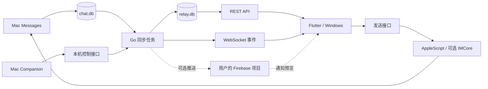

# micaGO 如何工作

micaGO 把 Mac 上的 Messages 提供给自己的其他设备。没有 micaGO 托管的账号服务或云端消息中继。公网代理和 Firebase 都由用户自行配置。

## 四个组件

| 组件 | 负责什么 | 代码入口 |
| --- | --- | --- |
| Go 服务端 | 读取 Messages、同步缓存、提供 API、执行发送 | [app.go](../MicaGoServer/micago-server/internal/app/app.go) |
| Mac Companion | 管理自有后端进程、配对、隧道和设置 | [MicaGoCompanionApp.swift](../MicaGoServer/micago-mac-companion/MicaGoCompanion/MicaGoCompanionApp.swift) |
| Flutter 客户端 | Android / Linux 上的聊天、缓存和交互 | [app_controller.dart](../MicaGoFlutterClient/lib/core/app_controller.dart) |
| Windows 客户端 | 独立的 WinUI 应用，与 Flutter 共用服务端协议 | [App.xaml.cs](../MicaGoWindowsClient/src/micaGO.App/App.xaml.cs) |

## 数据在哪里

`chat.db` 是 Apple Messages 的数据库，Go 只读它；发送通过 Messages 执行，随后再从数据库确认结果。

`relay.db` 是 micaGO 的服务端数据库。聊天、消息和附件索引可以从 Messages 重建，但配对凭据哈希、设备记录、同步规则、隐藏偏好和已读状态属于 micaGO 自己的数据。不能为了清缓存直接删除整个数据库。

客户端 SQLite 保存聊天缓存、已读镜像和待同步操作。客户端媒体目录保存下载文件。操作队列和普通缓存有不同的生命周期，清缓存不能顺手丢掉尚未同步的隐藏、已读或发送状态。

Mac 的 `~/.micago/config.yaml` 保存本机配置和管理员凭据，`tls/` 保存服务端 TLS 身份。备份与恢复时应一起考虑 `config.yaml`、`relay.db` 和 `tls/`。这些文件包含敏感信息，不应放进仓库。

## 读取与实时更新

同步任务从 `chat.db` 读取新增行，并检查已有消息的编辑、撤回、送达等变化。默认数据库轮询为 5 秒，另有文件变化触发；这不是固定送达时限。

只有按 ROWID 顺序读取的主扫描推进新增消息游标。按时间窗口补查和已有消息状态扫描使用各自的进度，不能跳过尚未读到的消息。没有变化的记录不应反复写入或广播。

REST 提供当前聊天、历史和增量数据。历史使用独立的分页游标；delta 使用同步游标。WebSocket 提供实时事件，客户端仍需用 delta 补齐离线或断线期间的数据。Windows 将实时事件作为增量同步提示；Flutter 也会处理实时消息内容，再用 delta 补漏。

## 谁决定状态

| 状态 | 以什么为准 |
| --- | --- |
| 已确认消息、附件与发送结果 | 服务端从 Messages 读取的记录 |
| 尚未确认的发送气泡 | 客户端临时状态；确认后与服务端消息合并 |
| 已读水位、手动未读、跨设备隐藏 | 服务端持久状态；客户端先本地更新并排队提交 |
| 联系人名字、头像、主题 | 各端的本地设置与联系人来源 |
| 当前网络线路 | 客户端选择；公网 URL 本身不决定发送到哪个聊天账号 |

同一联系人可能有多个电话或邮箱路线。消息身份、已读、隐藏和发送确认都要保留聊天路线，不能仅凭联系人名字合并。细节见[消息](features/messaging.md)和[未读](features/unread.md)。

## 信任边界

默认本机 HTTP 控制端口是 3000；设备 HTTPS/WSS 端口是 3001。公网代理转发到本机控制端口时，远程设备仍使用自己的凭据，不能取得管理员权限。

配对码是短期邀请，不是长期密码。设备换取独立凭据后，后续连接不依赖旧配对码。LAN 校验配对时的证书指纹，公网线路校验系统信任链。具体规则见[连接](features/connection.md)。

推送预览可能经过 Google；公网代理也可能终止 TLS。不能把这套传输描述为应用层端到端加密。数据范围见[通知](features/notifications.md)。

## 改动前看哪里

HTTP 路由集中在 [router.go](../MicaGoServer/micago-server/internal/httpapi/router.go)，数据库同步在 [relaydb](../MicaGoServer/micago-server/internal/relaydb)，Messages 读取在 [store](../MicaGoServer/micago-server/internal/store)。接口阅读入口见 [API 导航](reference/api.md)，各平台限制见[文档入口](index.md#platforms)。
